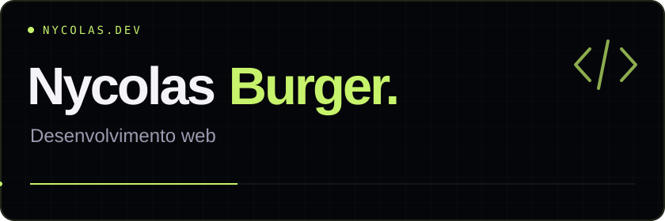

<picture>
  <source media="(max-width: 600px)" srcset="./assets/header-mobile.svg" />
  
</picture>

### Sites com identidade. Interfaces que conectam.

Sou **Nycolas Burger**, desenvolvedor web. Crio sites e aplicações com **React, Next.js, TypeScript e Node.js**, unindo visual e funcionalidade.

### Tecnologias

        

**Front-end** · React, Next.js, TypeScript e Tailwind CSS  
**Back-end** · Node.js, PostgreSQL e Supabase

---

**Tem uma ideia em mente?**  
Veja meus trabalhos e entre em contato pelo **[nycolasdev.com.br ↗](https://nycolasdev.com.br)**.
