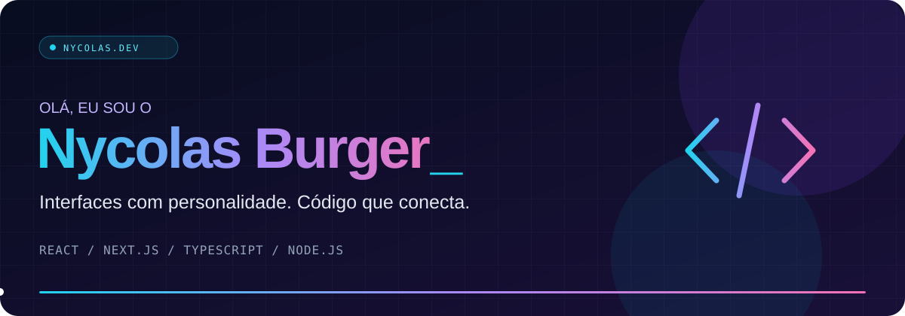

 

  

### ✦ Do primeiro pixel à última linha de código.

Desenvolvo **sites, interfaces e aplicações web** com atenção ao visual e à experiência de quem usa.  
Por aqui, compartilho código e minha evolução no desenvolvimento.

 

## ⚡ Minha stack

  

  

---

### 🚀 Quer ver o que estou construindo?

Meus trabalhos e canais de contato estão no meu portfólio.

### [nycolasdev.com.br ↗](https://nycolasdev.com.br)

 

Nycolas Burger · Desenvolvimento web

